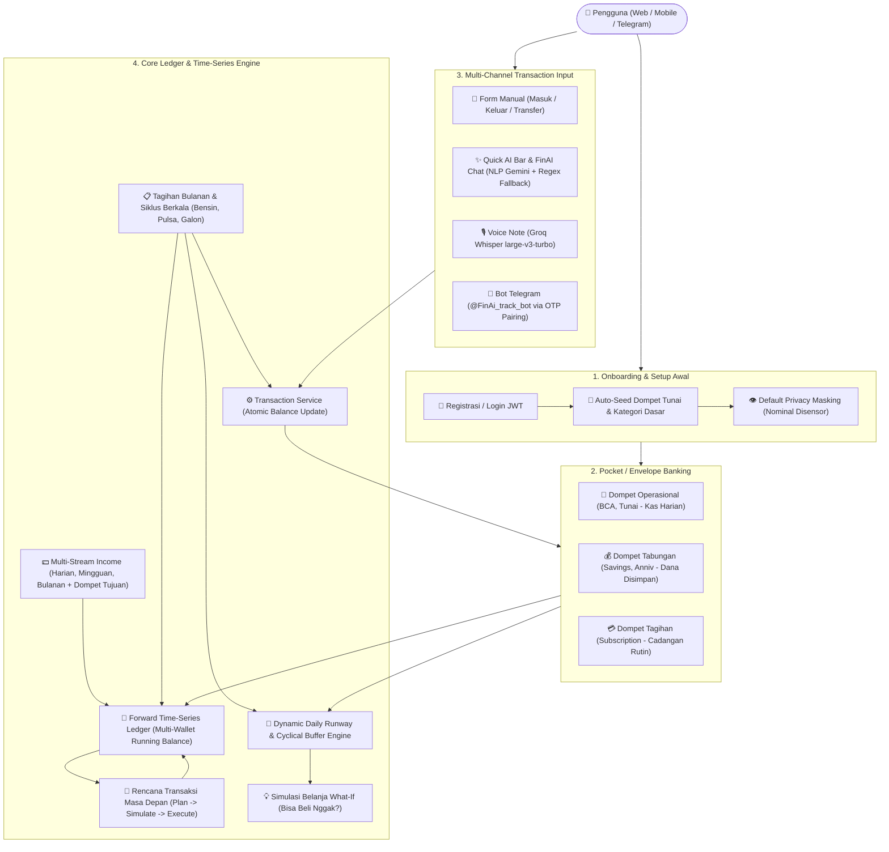
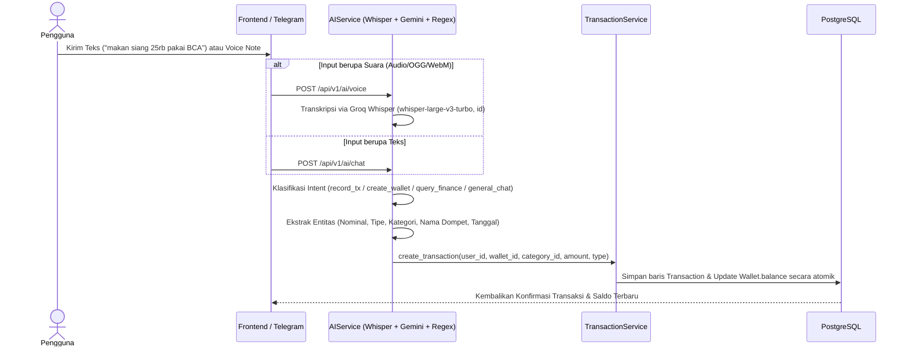
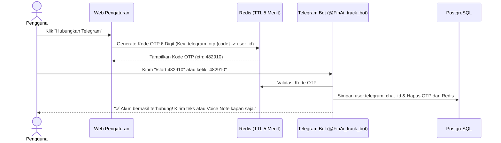
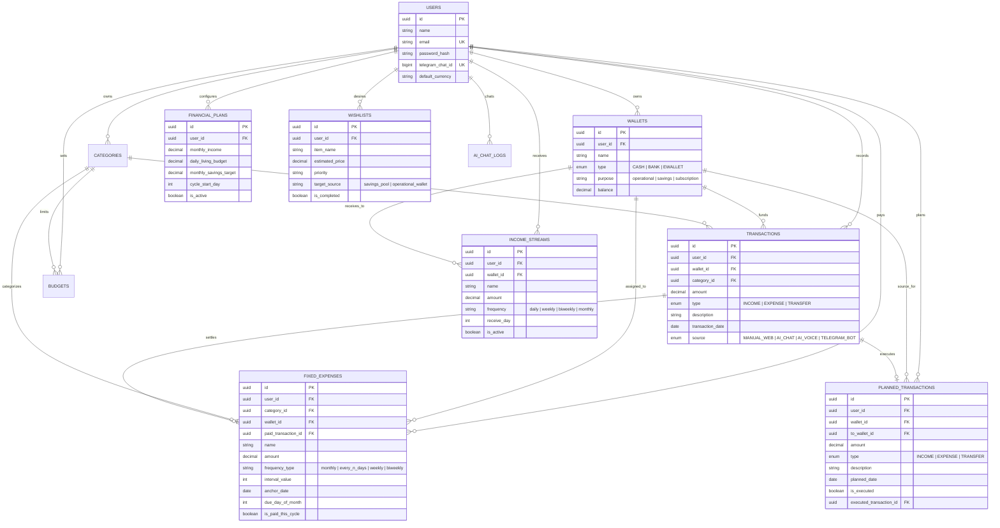

# Product Requirements Document (PRD) & Arsitektur Proses Bisnis: FinAI Track

**Nama Produk**: FinAI Track — *Smart Personal Finance & AI Runway Assistant*  
**Versi Dokumen**: 2.1 (Full-Stack MVP + Envelope Banking, Periodic Living Cycles & Time-Series Cashflow Engine)  
**Target Platform**: Mobile-First Web Application (Next.js) & Omnichannel Bot (Telegram)  

---

## 1. Ringkasan Eksekutif & Visi Produk

**FinAI Track** adalah aplikasi manajemen keuangan pribadi cerdas berbasis AI yang dirancang khusus untuk menjawab tiga masalah utama pengguna sehari-hari:
1. **Friksi Pencatatan Transaksi**: Mencatat pengeluaran manual terasa merepotkan. FinAI Track menyelesaikannya dengan input bahasa alami (*Natural Language Processing*), pesan suara (*Voice Note* via Groq Whisper), dan integrasi **Bot Telegram**.
2. **Ilusi Saldo Gabungan**: Banyak pengguna merasa uangnya masih banyak di rekening, padahal sebagian adalah uang tabungan atau uang tagihan rutin (seperti iCloud, listrik, kos). FinAI Track menerapkan **Pocket / Envelope Banking** yang memisahkan dompet `operational`, `savings`, dan `subscription`.
3. **Ketidakpastian Bertahan Hidup Sampai Gajian & Simulasi Saldo Masa Depan (*Time-Series Ledger*)**: Aplikasi keuangan biasa hanya memotret masa lalu (*backward-looking*) atau rata-rata statis. FinAI Track memiliki **Time-Series & Cyclical Cashflow Engine** yang memisahkan jatah makan dasar dengan siklus biaya hidup berkala (bensin tiap $N$ hari, pulsa 2-mingguan, galon mingguan), memproyeksikan saldo berjalan (*running balance*) per dompet hingga $N$ hari ke depan, serta memungkinkan pengujian skenario transaksi masa depan (*Planned Transactions*).

---

## 2. Arsitektur Proses Bisnis Utama (End-to-End Business Process)

Berikut adalah diagram alur proses bisnis utama yang menghubungkan pengguna, kanal input, manajemen amplop dompet, hingga mesin proyeksi finansial:

---

## 3. Spesifikasi Alur Lengkap per Modul (Detailed User & System Flows)

### 3.1. Modul Autentikasi, Onboarding & Privasi Saldo
* **Kode Terkait**: `backend/app/api/v1/auth.py`, `frontend/lib/store.ts`, `frontend/app/dashboard/page.tsx`
* **Alur Proses**:
  1. **Registrasi Akun Baru**: Saat pengguna mendaftar (`POST /api/v1/auth/register`), sistem secara atomik membuat akun, meng-hash password dengan `bcrypt`, lalu menjalankan *auto-seeding* berupa 1 dompet `Tunai` (`purpose="operational"`, saldo Rp0) serta 9 kategori standar pemasukan dan pengeluaran.
  2. **Privasi Default (*Balance Masking*)**: Saat pengguna pertama kali membuka Dashboard, state `isBalanceHidden` bernilai `true` secara default. Seluruh nominal saldo gabungan, pemasukan, pengeluaran, dan saldo per dompet disensor menjadi `Rp •••••••` hingga pengguna menekan tombol ikon mata.
  3. **Reset Akun Seperti Baru (*Factory Reset*)**: Di halaman Pengaturan (`POST /api/v1/auth/reset-data`), pengguna dapat mengetik kata konfirmasi `RESET` untuk menghapus seluruh transaksi, dompet tambahan, blueprint, tagihan pasti, dan wishlist, lalu mengembalikan akun ke kondisi awal (1 dompet Tunai Rp0) tanpa perlu membuat akun baru.

---

### 3.2. Modul Manajemen Dompet & Sistem Amplop (*Pocket / Envelope Banking*)
* **Kode Terkait**: `backend/app/models/wallet.py`, `backend/app/api/v1/wallets.py`, `frontend/app/settings/page.tsx`
* **Aturan Bisnis Peruntukan Dompet (`purpose`)**:
  Setiap dompet memiliki atribut `purpose` yang dapat diatur/diubah kapan saja dengan 1 klik dari halaman **Pengaturan** maupun halaman **Proyeksi**:

| Peruntukan (`purpose`) | Label UI | Fungsi dalam Proses Bisnis | Dampak ke Jatah Belanja Harian |
| :--- | :--- | :--- | :--- |
| **`operational`** | 💼 Operasional | Menyimpan uang kas harian/uang makan & jajan (cth: BCA, Tunai, GoPay). | **Menjadi pembilang utama** dalam perhitungan *Safe-to-Spend* & *Batas Belanja Ideal Hari Ini*. |
| **`savings`** | 💰 Tabungan | Menyimpan tabungan riil/dana darurat/tujuan khusus (cth: Savings, Anniv). | **Dikunci & Diamankan**. Tidak boleh ikut terbagi ke jatah belanja harian; dihitung sebagai *Tabungan Tersimpan*. |
| **`subscription`** | 💳 Tagihan | Menyimpan dana khusus pembayaran tagihan rutin bulanan (cth: Subscription). | **Dicadangkan untuk Tagihan**. Menanggung beban *Tagihan Pasti* agar tidak memotong uang makan harian. |

---

### 3.3. Modul Pencatatan Transaksi (Manual, Transfer, AI NLP & Voice Note)
* **Kode Terkait**: `backend/app/services/transaction_service.py`, `backend/app/services/ai_service.py`

* **3 Jenis Transaksi**:
  1. **Pemasukan (`INCOME`)**: Menambah saldo dompet tujuan (`wallet.balance += amount`).
  2. **Pengeluaran (`EXPENSE`)**: Mengurangi saldo dompet asal (`wallet.balance -= amount`).
  3. **Transfer Antar-Dompet (`TRANSFER`)**: Mengurangi saldo dompet asal dan menambah saldo dompet tujuan secara atomik (misal memindahkan gaji dari dompet `BCA` ke dompet `Savings` atau `Subscription`).
* **Hybrid AI Engine (Zero-Downtime NLP)**:
  - Menggunakan **Google Gemini (`gemini-flash-latest`)** untuk ekstraksi entitas kontekstual.
  - Dilengkapi **Deterministic Regex Engine** sebagai *instant fallback* jika kuota API habis atau jaringan lambat, yang mampu memahami singkatan bahasa Indonesia sehari-hari (`25rb`, `25k`, `1,5jt`, `gajian`, `bayar kos pakai bca`, dll) hingga multi-transaksi dalam satu kalimat.

---

### 3.4. Modul Proyeksi, Siklus Biaya Hidup Berkala & Time-Series Cashflow Engine
* **Kode Terkait**: `backend/app/services/forecast_service.py`, `backend/app/api/v1/forecast.py`, `frontend/app/forecast/page.tsx`

Modul ini adalah inti kecerdasan finansial FinAI Track yang mengubah pencatatan keuangan konvensional menjadi simulasi buku besar masa depan (*forward-looking time-series ledger*) dengan akurasi tinggi:

#### A. Multi-Stream Income (Aliran Pendapatan Multi-Siklus + Dompet Tujuan)
Pengguna yang memiliki lebih dari 1 sumber pemasukan dengan jadwal berbeda dapat mendaftarkan rincian aliran pendapatan (`IncomeStream`):
- **Harian (`daily`)**: $\text{Ekuivalen Bulanan} = \text{Nominal} \times \text{Total Hari Siklus}$
- **Mingguan (`weekly`)**: $\text{Ekuivalen Bulanan} = \text{Nominal} \times (\frac{\text{Total Hari Siklus}}{7})$ (dilengkapi penanda hari cair 1=Senin s/d 7=Minggu).
- **2-Mingguan (`biweekly`)**: $\text{Ekuivalen Bulanan} = \text{Nominal} \times (\frac{\text{Total Hari Siklus}}{14})$ (dilengkapi tanggal acuan awal `anchor_date`).
- **Bulanan (`monthly`)**: $\text{Ekuivalen Bulanan} = \text{Nominal}$ (dilengkapi tanggal gajian 1–31).
- **Target Dompet Penerima (`wallet_id`)**: Setiap pendapatan dapat ditautkan ke dompet spesifik (misal Gaji Bulanan masuk ke `BCA`, Pendapatan Freelance masuk ke `GoPay`), sehingga saat disimulasikan pada rentang tanggal, dana otomatis menambah saldo dompet yang bersangkutan.

#### B. Tagihan Bulanan vs Siklus Biaya Hidup Berkala (*Periodic Living Cycles*)
Sistem membedakan dua jenis pengeluaran rutin:
1. **Tagihan Pasti Bulanan (`frequency_type="monthly"`)**:
   - Tagihan yang jatuh tempo pada tanggal tertentu (1–31) setiap bulan (misal: *iCloud*, *Kost*, *Wi-Fi*).
   - Memiliki fitur **1-Tap Checklist Lunas / Belum Lunas** dengan auto-debit dan instant refund pada dompet pembayar.
2. **Siklus Biaya Hidup Berkala (`every_n_days`, `weekly`, `biweekly`)**:
   - Pengeluaran variabel berulang jarak pendek/menengah yang tidak bisa disamaratakan ke uang makan harian:
     - **Interval $N$ Hari (`every_n_days`)**: Misal *Bensin Rp35.000 setiap 4 hari* (menggunakan `anchor_date` untuk menghitung hari jatuh tempo: `(t - anchor_date).days % interval == 0`).
     - **Mingguan (`weekly`)**: Misal *Belanja Pasar / Galon Rp60.000 setiap hari Sabtu*.
     - **2-Mingguan (`biweekly`)**: Misal *Pulsa & Kuota Rp50.000 setiap 14 hari*.
   - Setiap siklus ditautkan langsung ke dompet asal (`wallet_id`), sehingga beban lonjakan biaya hidup memotong dompet yang tepat.

#### C. Pemisahan "Uang Makan Dasar" & Dynamic Daily Runway
Untuk mencegah uang bensin dan pulsa terbagi ke jatah makan harian, sistem memisahkan **Patokan Makan & Jajan Harian Dasar** (`daily_living_budget`) dari siklus berkala:

$$\text{Cyclical Buffer} = \sum \text{Estimasi Biaya Siklus Berkala yang Jatuh Tempo pada Sisa Siklus}$$

$$\text{Safe to Spend Murni} = \max\left(0, \text{Saldo Operasional Bebas} - \text{Sisa Tagihan Bulanan} - \text{Cyclical Buffer}\right)$$

$$\text{Daily Cash Runway} = \frac{\text{Safe to Spend Murni}}{\text{Sisa Hari dalam Siklus}}$$

$$\text{Batas Belanja Ideal Hari Ini} = \begin{cases} \min(\text{daily\_living\_budget}, \text{Daily Cash Runway}) & \text{jika } \text{daily\_living\_budget} > 0 \\ \text{Daily Cash Runway} & \text{jika } \text{daily\_living\_budget} = 0 \end{cases}$$

Dengan formula ini, dana bensin dan kuota sudah diamankan (*reserved*) terlebih dahulu, sehingga pengguna tidak mengalami ilusi bahwa mereka memiliki uang makan lebih besar dari kenyataannya.

#### D. Forward-Looking Time-Series Engine (Simulasi Buku Besar Masa Depan)
Fitur `POST /api/v1/forecast/range-projection` memungkinkan pengguna memprediksi saldo berjalan (*running balance*) hari-demi-hari untuk rentang waktu kustom ($t_0 \rightarrow t_n$):
- **Cakupan Dompet Fleksibel**:
  - `all_operational`: Menggabungkan seluruh dompet kas operasional.
  - `all_savings`: Khusus memproyeksikan saldo tabungan.
  - `all_wallets`: Menggabungkan seluruh aset.
  - Dompet Spesifik (UUID): Memilih satu dompet tertentu (misal: hanya dompet `BCA` atau `Tunai`).
  - `custom_balance`: Saldo simulasi bayangan (misal: menginput Rp1.500.000 tanpa mengubah data riil database).
- **Rumus Saldo Berjalan Harian (*Rolling Balance Formula*)**:
  $$\text{Saldo Akhir}_W(t) = \text{Saldo Akhir}_W(t-1) + \text{Inflow}_W(t) - \text{Outflow}_W(t)$$
  Di mana untuk setiap tanggal $t$:
  $$\text{Inflow}_W(t) = \text{IncomeStream}_W(t) + \text{Rencana Pemasukan/Transfer Masuk}_W(t)$$
  $$\text{Outflow}_W(t) = \text{Jatah Makan Harian}_W + \text{Siklus Berkala}_W(t) + \text{Tagihan Bulanan}_W(t) + \text{Rencana Pengeluaran/Transfer Keluar}_W(t)$$
- **Pencegahan Pengurangan Ganda (*Double-Deduction Prevention*)**:
  Pada hari pertama ($t_0$), jika sistem mendeteksi sudah ada transaksi riil yang tercatat di database, komponen jatah makan dasar harian tidak dikurangkan lagi agar pengeluaran riil tidak terpotong dua kali.

#### E. Siklus Hidup Rencana Transaksi Masa Depan (*Planned Transactions*)
Pengguna dapat menguji dampak rencana transaksi dadakan (misal: *Servis Motor Rp150.000 di tanggal 12* atau *Transfer Rp300.000 ke Tabungan di tanggal 15*):
1. **Plan & Simulate**: Disimpan ke tabel `PLANNED_TRANSACTIONS` dengan tanggal rencana (`planned_date`) dan dompet sumber/tujuan. Mesin Time-Series langsung memproyeksikan dampaknya ke saldo berjalan hari berikutnya dan menampilkan indikator status `SAFE` atau `DEFICIT` jika saldo anjlok ke bawah nol.
2. **Execute (`POST /planned-transactions/{id}/execute`)**: Saat transaksi benar-benar terjadi di dunia nyata, pengguna cukup menekan tombol **⚡ Eksekusi**. Sistem secara atomik:
   - Membuat baris riwayat di tabel `TRANSACTIONS`.
   - Menyesuaikan saldo dompet terkait (`wallet.balance`).
   - Menandai `is_executed = True` dan menautkan `executed_transaction_id`.

#### F. Simulasi Belanja *"Bisa Beli Nggak?"* (*What-If Simulator*) & Wishlist
Sebelum membeli barang sekunder/tersier (misal: *Sepatu Rp350.000*), pengguna dapat menguji kelayakannya:
1. **Ambil dari Tabungan (`savings_pool`)**: Menguji apakah saldo tabungan mencukupi tanpa menurunkan rasio cadangan darurat di bawah 50%.
2. **Ambil dari Operasional (`operational_wallet`)**: Menghitung dampak penurunan jatah makan harian untuk sisa bulan ini, dengan rekomendasi vonis: `✅ Aman Dibeli`, `⚠️ Jatah Harian Menjadi Ketat`, atau `❌ Jangan Beli (Boncos)`.

---

### 3.5. Modul Integrasi Omnichannel Bot Telegram
* **Kode Terkait**: `backend/app/services/telegram_bot.py`, `backend/app/api/v1/telegram.py`

* **Kemampuan Bot Telegram**:
  - Menerima chat natural (contoh: *"beli bensin 35rb pakai tunai"*) dan langsung mencatat ke database yang sama dengan Web.
  - Menerima **Voice Note Telegram** (`.ogg`), mengunduh file dari server Telegram, mentranskripsikannya lewat Groq Whisper API, mengekstrak transaksi, dan membalas rincian pencatatan beserta sisa saldo dompet secara *real-time*.

---

## 4. Arsitektur Data (Entity-Relationship Diagram)

Berikut adalah skema relasi tabel di database PostgreSQL yang menopang seluruh proses bisnis di atas:

---

## 5. Peta Navigasi UI & Fitur Frontend (Mobile-First 5 Menu Utama)

Aplikasi dirancang dengan kerangka simulator smartphone (`iPhone 15 Pro Max` frame pada layar desktop, dan *native full-screen* pada perangkat mobile) dengan 5 tab navigasi bawah (*Bottom Navigation Bar*):

1. **🏠 Dashboard (`/dashboard`)**:
   - *Quick AI Input Bar* (Teks & Rekam Suara langsung di atas halaman).
   - *Hero Card* Total Saldo Gabungan dengan *Privacy Eye Toggle* (sensor nominal default).
   - Ringkasan Pemasukan & Pengeluaran bulan berjalan + 3 tombol aksi cepat (`+ Masuk`, `- Keluar`, `⇄ Transfer`).
   - Grid Dompet & Rekening beserta badge peruntukan (`Tabungan`, `Tagihan`).
   - Visualisasi Grafik *Donut Category Breakdown* & *7-Days Cashflow Bar Chart* serta 5 transaksi terakhir.
2. **🧭 Proyeksi (`/forecast`)**:
   - *Hero Card* **Batas Belanja Hari Ini** (`/ hari Ideal`), bar progres pemakaian hari ini, *Saldo Operasional Bebas*, *Daya Tahan Uang (Runway)*, dan *Tabungan Tersimpan*.
   - Strip rincian amplop (`Operasional`, `Tabungan`, `Tagihan`) + tombol **`⚙️ Atur Dompet`** untuk mengubah fungsi dompet secara instan.
   - Tombol **`Blueprint`** untuk mengatur multi-sumber pendapatan (dengan pemilihan dompet tujuan), **Siklus Biaya Hidup Berkala** (Bensin, Pulsa, Galon), patokan makan harian dasar, target tabungan, dan tanggal gajian.
   - **Tab 1: 📅 Proyeksi & Runway**:
     - *Sub-View Switcher*: `🔮 Prediksi Saldo Masa Depan` vs `📜 Realisasi Siklus Berjalan`.
     - *Filter Bar Proyeksi*: Pemilihan dompet (`Semua Operasional`, `Semua Tabungan`, `Semua Dompet`, dompet spesifik, atau `🧪 Saldo Kustom`), tombol preset rentang waktu (7 Hari, 14 Hari, Sisa Siklus, atau Tanggal Bebas), serta toggle hitung jatah makan harian.
     - *Kartu Ringkasan Proyeksi*: Saldo Awal, Total Masuk, Total Keluar, Prediksi Saldo Akhir, dan status kelayakan (`✅ AMAN` / `⚠️ RISIKO DEFISIT`).
     - *Timeline Buku Besar Berjalan (Forward Daily Ledger)*: Visualisasi hari-demi-hari mutasi masuk/keluar, badge event (`GAJI`, `MAKAN`, `BENSIN/SIKLUS`, `TAGIHAN`, `RENCANA`), dan saldo berjalan harian.
     - *Manajemen Rencana Transaksi (Planned Transactions)*: Tombol `+ Rencana Transaksi` dan tombol aksi instan `⚡ Eksekusi` untuk merealisasikan rencana ke saldo dompet nyata.
   - **Tab 2: 📋 Tagihan & Siklus**:
     - Sub-filter tab (`Semua`, `Bulanan`, `Siklus`).
     - Kartu item tagihan/siklus dengan badge frekuensi, dompet pembayar, dan tombol edit/hapus.
     - 1-Tap Toggle Lunas/Belum Lunas khusus untuk tagihan bulanan.
   - **Tab 3: 💡 Simulasi**:
     - Kalkulator simulasi belanja *"Bisa Beli Nggak?"* (menguji pemotongan dari Tabungan vs Operasional).
     - Daftar barang impian (*Wishlist*) terintegrasi.
3. **✨ FinAI (`/ai`)**:
   - Antarmuka *conversational assistant* dengan dukungan mikrofon suara dan teks.
   - *Smart Budget Generator* untuk menyusun alokasi anggaran otomatis berbasis persentase kategori.
4. **🧾 Transaksi (`/transactions`)**:
   - Riwayat lengkap seluruh transaksi dengan pencarian kata kunci, filter tipe (`INCOME`, `EXPENSE`), dan penghapusan transaksi (otomatis mengembalikan saldo dompet).
5. **⚙️ Pengaturan (`/settings`)**:
   - Kartu penautan **Bot Telegram** via kode OTP 6 digit.
   - Manajemen **Dompet & Rekening** (Tambah, Edit detail & peruntukan amplop, Dropdown cepat ganti fungsi dompet, Hapus).
   - Manajemen **Kategori** kustom.
   - *Danger Zone*: **Reset Seluruh Data Finansial** untuk mengembalikan akun bersih seperti baru.

---

## 6. Spesifikasi Endpoint REST API (`/api/v1`)

| Grup Modul | Method & Endpoint | Deskripsi Fungsi Bisnis |
| :--- | :--- | :--- |
| **Auth** | `POST /auth/register` | Registrasi user + auto-seed dompet Tunai & kategori dasar |
| | `POST /auth/login` | Autentikasi email/password & penerbitan JWT Bearer Token |
| | `GET /auth/me` | Profil pengguna yang sedang login |
| | `POST /auth/reset-data` | Hapus seluruh data finansial user & reset ke 1 dompet Tunai Rp0 |
| **Wallets** | `GET /wallets` | Daftar seluruh dompet milik user |
| | `POST /wallets` | Buat dompet baru beserta tipe & `purpose` (`operational`/`savings`/`subscription`) |
| | `PUT /wallets/{id}` | Ubah nama, tipe, saldo, atau peruntukan (`purpose`) dompet |
| | `DELETE /wallets/{id}` | Hapus dompet |
| **Transactions** | `GET /transactions` | Daftar transaksi dengan filter tanggal, tipe, dompet, kategori |
| | `POST /transactions` | Catat pemasukan, pengeluaran, atau transfer antar-dompet |
| | `DELETE /transactions/{id}` | Hapus transaksi & kembalikan (*rollback*) saldo dompet secara atomik |
| **Dashboard** | `GET /dashboard/summary` | Agregasi saldo, arus kas bulanan, breakdown kategori, dan tren 7 hari |
| **Forecast & Time-Series** | `GET /forecast/summary` | Mesin penghitung jatah ideal harian (dengan cyclical buffer), runway, & amplop saldo |
| | `POST /forecast/range-projection` | **Mesin Simulasi Time-Series**: Hitung saldo harian berjalan per dompet pada rentang waktu kustom |
| | `GET /forecast/daily-ledger` | Rekap perbandingan belanja aktual vs ideal per tanggal dalam 1 siklus |
| | `GET, PUT /forecast/plan` | Ambil & simpan parameter Blueprint Keuangan |
| | `GET, POST, DELETE /forecast/income-streams` | Kelola multi-sumber pendapatan (harian, mingguan, bulanan) + dompet tujuan |
| | `GET, POST, DELETE /forecast/fixed-expenses` | Kelola tagihan bulanan & siklus biaya hidup berkala (bensin, pulsa) |
| | `PUT /forecast/fixed-expenses/{id}` | Update rincian tagihan bulanan atau parameter siklus berkala |
| | `POST /forecast/fixed-expenses/{id}/toggle-paid` | 1-Tap toggle lunas tagihan (auto-debit/refund dompet & catat transaksi) |
| | `GET, POST, PUT, DELETE /forecast/planned-transactions` | Kelola rencana transaksi masa depan untuk simulasi arus kas |
| | `POST /forecast/planned-transactions/{id}/execute` | Eksekusi rencana transaksi menjadi mutasi riil di database & dompet |
| | `POST /forecast/simulate` | Kalkulator simulasi belanja *"Bisa Beli Nggak?"* |
| | `GET, POST, DELETE /forecast/wishlists` | Kelola daftar barang impian (Wishlist) |
| **AI Assistant** | `POST /ai/chat` | Pemrosesan perintah teks natural (catat transaksi, buat dompet, tanya keuangan) |
| | `POST /ai/voice` | Upload rekaman suara $\rightarrow$ Transkripsi Groq Whisper $\rightarrow$ Eksekusi AI Chat |
| | `POST /ai/budget-plan` | Rekomendasi pembagian anggaran otomatis berbasis AI |
| **Telegram** | `POST /telegram/pairing-code` | Buat kode OTP 6 digit di Redis untuk penautan akun Telegram |
| | `GET /telegram/status` | Cek status keterhubungan akun dengan Bot Telegram |
| | `DELETE /telegram/unlink` | Putuskan tautan Bot Telegram dari akun |
