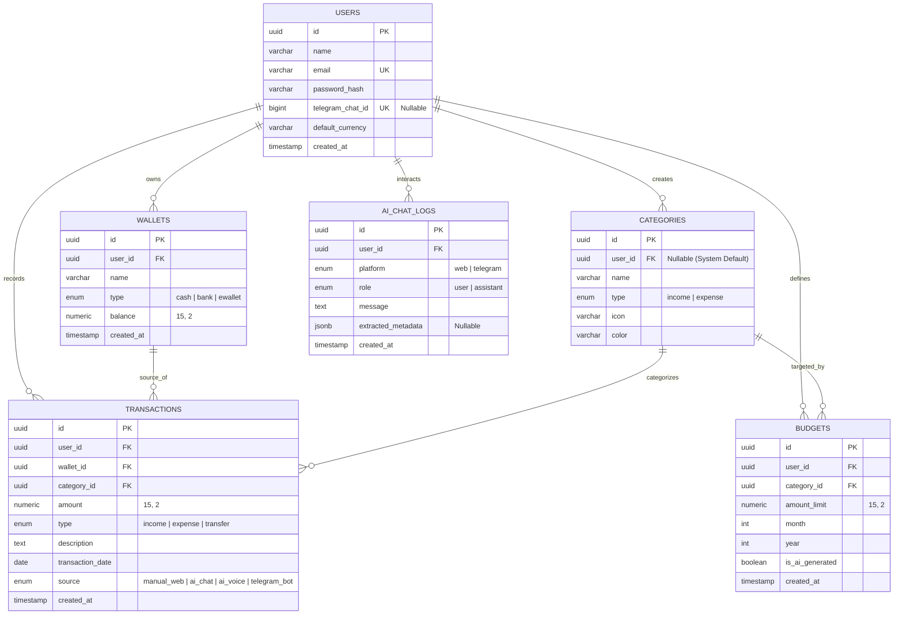
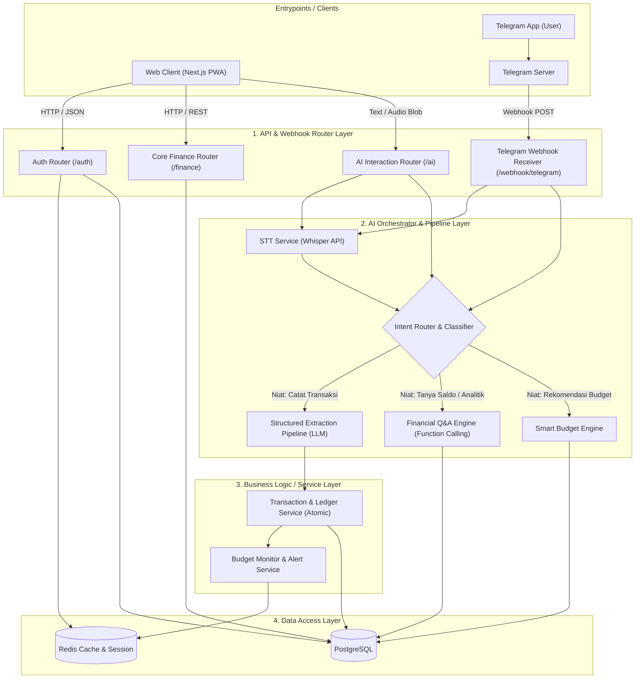

# Product Requirements Document (PRD)
# FinAI Track — Smart Personal Finance & AI Assistant

---

## Ringkasan Proyek (Document Overview)

| Atribut | Keterangan |
| :--- | :--- |
| **Nama Proyek (Working Title)** | **FinAI Track** |
| **Tipe Produk** | B2C SaaS (*Software as a Service*) — *Personal Finance Management* |
| **Target Platform** | • **Fase 1:** Web (PWA) & Bot Telegram<br>• **Fase 2:** Android (Flutter)<br>• **Fase 3:** iOS (Flutter) |
| **Status Dokumen** | **Draft v1.0** (Fokus: MVP & Portofolio Teknis) |
| **Versi Dokumen** | `1.0.0` |

---

## 1. Product Vision

Membangun asisten manajemen keuangan pribadi cerdas berbasis **Artificial Intelligence (AI)** yang menghilangkan rasa malas mencatat keuangan melalui interaksi bahasa alami (*natural language processing* via obrolan teks dan suara), serta membantu individu mencapai target finansial secara proaktif melalui *automated budgeting* yang adaptif dan lintas platform.

---

## 2. Problem Statement

1. **Friksi Input Manual yang Tinggi**  
   Pengguna aplikasi keuangan konvensional sering berhenti mencatat di minggu kedua karena lelah harus membuka aplikasi, memilih kategori, memilih dompet/rekening, dan mengetik nominal secara manual setiap kali selesai bertransaksi.
2. **Data Pasif & Sulit Dianalisis**  
   Grafik standar sering kali hanya menampilkan riwayat masa lalu tanpa mampu menjawab pertanyaan spesifik pengguna secara instan (contoh: *"Kira-kira kalau saya beli barang X minggu ini, uang makan masih aman tidak?"*).
3. **Anggaran (*Budget*) yang Kaku**  
   Pembuatan anggaran manual tidak memperhitungkan pola historis pengguna dan sulit disesuaikan kembali (*rebalancing*) ketika terjadi pengeluaran tidak terduga di pertengahan bulan.

---

## 3. User Persona

| Atribut | Persona 1: "Si Sibuk & Praktis" | Persona 2: "Si Perencana Target" |
| :--- | :--- | :--- |
| **Segmen** | *Young Professional / Freelancer* | *Mahasiswa / First-Jobber* |
| **Profil** | Usia 21–30 tahun, mobilitas tinggi, aktif menggunakan beberapa rekening bank dan *e-wallet*. | Usia 18–24 tahun, pemasukan bulanan terbatas, sedang menabung untuk target spesifik (misal: *upgrade gear*, dana darurat). |
| **Pain Points** | Malas membuka aplikasi khusus hanya untuk mencatat parkir Rp5.000 atau membeli kopi di sela aktivitas. | Sering *overspending* di awal bulan untuk nongkrong, bingung membagi alokasi uang harian agar cukup hingga akhir bulan. |
| **Kebutuhan Utama** | Mencatat pengeluaran melalui rekaman suara (*Voice Note*) atau pesan singkat di Telegram sambil beraktivitas. | Memerlukan AI yang otomatis menyusun alokasi anggaran bulanan serta memberikan peringatan proaktif saat mendekati batas anggaran. |

---

## 4. MVP Scope (Fase 1 — Fokus Portofolio & Web/PWA)

Untuk memastikan proyek selesai tepat waktu dengan kualitas arsitektur yang solid sebagai portofolio teknis, ruang lingkup MVP dibatasi sebagai berikut:

### In-Scope (Dikerjakan di MVP)
- [x] **Autentikasi Pengguna:** Registrasi, Login, dan Pengelolaan Sesi menggunakan JWT (*JSON Web Token*).
- [x] **Manajemen Multi-Dompet & Kategori:** Pengelolaan rekening/dompet (*Cash*, Bank, *E-Wallet*) serta kategori kustom (*Income/Expense*).
- [x] **Input Manual & Visualisasi Dashboard:** Input transaksi via form web dan visualisasi arus kas harian/bulanan (Donut Chart & Bar Chart).
- [x] **In-App AI Chatbot:** Ekstraksi teks bahasa alami menjadi data transaksi terstruktur otomatis & Q&A analitik data keuangan pribadi.
- [x] **AI Speech-to-Text (Voice Logging):** Rekam suara langsung dari Web/PWA untuk mencatat transaksi secara instan.
- [x] **Integrasi Bot Telegram Dua Arah:** Penautan akun (*Account Linking* via pairing token), pencatatan transaksi via teks/suara di Telegram, dan tanya-jawab saldo/pengeluaran.
- [x] **AI Automated Budgeting:** Pembuatan alokasi anggaran bulanan adaptif berdasarkan prompt pengguna dan data historis transaksi.
- [x] **Konfigurasi PWA (*Progressive Web App*):** Dukungan instalasi aplikasi langsung di Android dan iOS melalui browser.

### Out-of-Scope (Ditunda ke Fase Berikutnya)
- [ ] Integrasi *Payment Gateway* / langganan berbayar (Monetisasi SaaS).
- [ ] Sinkronisasi mutasi rekening otomatis (*Open Banking API*).
- [ ] Fitur OCR untuk memindai foto struk belanja fisik.
- [ ] Distribusi biner *native* ke Google Play Store & Apple App Store (akan diimplementasikan dengan Flutter pada Fase 2 & 3).

---

## 5. Core Features

### 5.1. Smart Multimodal Logging (Text & Voice)
- Mengubah input bahasa kasual (contoh: *"Tadi beli nasi padang 25rb pakai QRIS BCA"*) atau rekaman suara menjadi entitas data terstruktur:
  - **Tipe:** `Expense`
  - **Nominal:** `25000`
  - **Kategori:** `Makanan`
  - **Dompet:** `BCA`
  - **Tanggal:** `Hari ini`

### 5.2. Contextual Financial Q&A (RAG / Function Calling)
- Asisten AI cerdas dengan akses *read-only* ke data pengguna melalui *tool/function calling*.
- Mampu menjawab kueri analitik seperti perbandingan pengeluaran antar-bulan, total belanja kategori tertentu, atau sisa anggaran berjalan.

### 5.3. Seamless Telegram Bot Sync
- Sinkronisasi *real-time* dua arah antara bot Telegram dan database utama.
- Transaksi yang dicatat via obrolan Telegram langsung memperbarui saldo dompet dan grafik visual di Web Dashboard secara instan.

### 5.4. AI Dynamic Budgeting Engine
- Menerima batasan (*constraints*) dari pengguna (total pemasukan, target tabungan wajib, dan batas kategori tertentu).
- Mendistribusikan plafon anggaran ke seluruh kategori pengeluaran secara proporsional dengan mempertimbangkan rata-rata historis.

### 5.5. Core Ledger & Analytics
- Pencatatan transaksi mutasi antar-dompet (*Transfer*), pemasukan, dan pengeluaran.
- Rekapitulasi arus kas bersih (*Net Cashflow*) serta indikator progres pemakaian anggaran (*Aman*, *Waspada*, *Overbudget*).

---

## 6. Tech Stack

| Lapisan Sistem | Teknologi | Justifikasi Teknis |
| :--- | :--- | :--- |
| **Frontend Web (Fase 1)** | Next.js (React), TypeScript, Tailwind CSS | Mendukung interaktivitas sisi klien yang tinggi untuk rekaman audio, *streaming chat* AI, dan konfigurasi PWA. |
| **State & Data Fetching** | Zustand & TanStack Query (React Query) | Manajemen state global (*user*, dompet) yang ringan serta *caching* respons API yang optimal agar transisi antar halaman instan. |
| **Mobile App (Fase 2 & 3)** | Flutter (Dart) | *Single codebase* untuk kompilasi *native* ke Android dan iOS menggunakan kontrak API backend yang sama. |
| **Backend API & AI Core** | FastAPI (Python) | Kinerja *asynchronous* tinggi, validasi skema ketat menggunakan Pydantic, dan ekosistem *native* terbaik untuk manipulasi AI/Data. |
| **Database & ORM** | PostgreSQL + SQLAlchemy / SQLModel + Alembic | Keandalan ACID untuk data transaksi finansial, dukungan kolom `JSONB` untuk log metadata AI, serta migrasi skema yang terkelola rapi. |
| **AI & LLM Orchestration** | Gemini 2.5 Flash / GPT-4o-mini + LangChain / Instructor | Latensi ultra-rendah, efisiensi biaya, serta dukungan *Structured Outputs* (Pydantic schema) dan *Function Calling*. |
| **Speech-to-Text (STT)** | Groq Whisper API (`whisper-large-v3-turbo`) | Transkripsi audio Bahasa Indonesia berkecepatan tinggi (< 1 detik) dengan tingkat akurasi transkripsi yang sangat baik. |
| **Telegram Integration** | aiogram / python-telegram-bot (Webhook Mode) | Berjalan secara *asynchronous* langsung di dalam *event loop* FastAPI tanpa memblokir *request thread*. |
| **Caching & Rate Limiter** | Redis | Penyimpanan memori percakapan singkat (*chat memory context*), *rate limiting*, dan kode OTP penautan akun Telegram. |
| **Deployment & Infra** | Docker, Docker Compose, Vercel (FE), VPS / Render (BE) | Kontainerisasi menjamin konsistensi *environment* dari pengembangan lokal hingga ke tahap *production*. |

---

## 7. Scalability Plan (Strategi Scale-Up)

Ketika aplikasi berkembang dari proyek portofolio menjadi produk publik dengan ribuan pengguna aktif, sistem dirancang untuk dapat ditingkatkan melalui strategi berikut:

1. **Pemisahan Beban Kerja Asynchronous (Message Queue)**
   - *Tantangan:* Ketika lonjakan pengguna mengirim *Voice Note* bersamaan di Telegram, *worker thread* FastAPI dapat terhambat menunggu respons API Whisper & LLM.
   - *Solusi:* Memasang Celery / ARQ dengan Redis Broker. FastAPI segera merespons *"Sedang diproses..."*, sementara pemrosesan audio STT dan ekstraksi AI diproses di latar belakang (*background worker*).
2. **Optimasi Database & Indexing**
   - Menambahkan *Composite Index* pada kolom `(user_id, transaction_date)` dan `(user_id, category_id)` di PostgreSQL agar kueri analitik bulanan tetap dieksekusi di bawah 50ms meskipun data mencapai jutaan baris.
   - Menggunakan *Connection Pooling* (PgBouncer) untuk menangani lonjakan koneksi konkuren dari instans *serverless* atau *container* FastAPI.
3. **Efisiensi Token AI & Semantic Caching**
   - Menyimpan agregasi ringkasan pengeluaran bulanan pengguna di Redis. Saat pengguna menanyakan hal serupa berulang kali dalam sesi yang sama, AI membaca *cache summary* tanpa perlu menjalankan kueri SQL berat ke PostgreSQL.
4. **Horizontal Scaling (Stateless Backend)**
   - Autentikasi berbasis JWT (*Stateless*) dan status percakapan tersimpan di Redis memungkinkan *container* FastAPI digandakan (*replica scaling*) di belakang *Load Balancer* (Nginx / Cloudflare) tanpa risiko kehilangan status sesi pengguna.

---

## 8. Skema Database (Relational Schema)

Seluruh tabel menerapkan isolasi data ketat berbasis pengguna melalui relasi foreign key `user_id` (*Multi-tenant Ready*).

### 8.1. Entity-Relationship Diagram (ERD)



### 8.2. Detail Tabel & Spesifikasi Kolom

#### 1. `users`
Menyimpan identitas akun pengguna dan konfigurasi global.
- `id` (UUID, Primary Key)
- `name` (VARCHAR, Not Null)
- `email` (VARCHAR, Unique, Not Null)
- `password_hash` (VARCHAR, Not Null)
- `telegram_chat_id` (BIGINT, Unique, Nullable) — ID obrolan Telegram setelah proses *account linking*.
- `default_currency` (VARCHAR, Default: `'IDR'`)
- `created_at` (TIMESTAMP WITH TIME ZONE, Default: `NOW()`)

#### 2. `wallets`
Menyimpan rekening bank, dompet digital, atau uang tunai milik pengguna.
- `id` (UUID, Primary Key)
- `user_id` (UUID, Foreign Key $\rightarrow$ `users.id`, Index)
- `name` (VARCHAR, Not Null — contoh: "BCA", "GoPay", "Uang Tunai")
- `type` (ENUM: `'cash'`, `'bank'`, `'ewallet'`)
- `balance` (NUMERIC(15, 2), Default: `0.00`)
- `created_at` (TIMESTAMP WITH TIME ZONE, Default: `NOW()`)

#### 3. `categories`
Menyimpan kategori transaksi baik bawaan sistem (*global*) maupun buatan pengguna (*custom*).
- `id` (UUID, Primary Key)
- `user_id` (UUID, Foreign Key $\rightarrow$ `users.id`, Nullable — bernilai NULL jika kategori *default* bawaan sistem)
- `name` (VARCHAR, Not Null — contoh: "Makanan & Minuman", "Gaji")
- `type` (ENUM: `'income'`, `'expense'`)
- `icon` (VARCHAR, Nullable — penanda ikon UI)
- `color` (VARCHAR, Nullable — kode warna hex)

#### 4. `transactions`
Buku besar utama pencatatan mutasi keuangan.
- `id` (UUID, Primary Key)
- `user_id` (UUID, Foreign Key $\rightarrow$ `users.id`, Index)
- `wallet_id` (UUID, Foreign Key $\rightarrow$ `wallets.id`, Index)
- `category_id` (UUID, Foreign Key $\rightarrow$ `categories.id`, Index)
- `amount` (NUMERIC(15, 2), Not Null)
- `type` (ENUM: `'income'`, `'expense'`, `'transfer'`)
- `description` (TEXT, Nullable)
- `transaction_date` (DATE, Not Null)
- `source` (ENUM: `'manual_web'`, `'ai_chat'`, `'ai_voice'`, `'telegram_bot'`) — Melacak asal input untuk analitik penggunaan fitur.
- `created_at` (TIMESTAMP WITH TIME ZONE, Default: `NOW()`)

#### 5. `budgets`
Menyimpan alokasi target batas pengeluaran bulanan per kategori.
- `id` (UUID, Primary Key)
- `user_id` (UUID, Foreign Key $\rightarrow$ `users.id`, Index)
- `category_id` (UUID, Foreign Key $\rightarrow$ `categories.id`, Index)
- `amount_limit` (NUMERIC(15, 2), Not Null)
- `month` (INT, Not Null, Range 1–12)
- `year` (INT, Not Null)
- `is_ai_generated` (BOOLEAN, Default: `FALSE`)
- `created_at` (TIMESTAMP WITH TIME ZONE, Default: `NOW()`)

#### 6. `ai_chat_logs`
Menyimpan histori interaksi asisten AI untuk audit dan analisis konteks percakapan.
- `id` (UUID, Primary Key)
- `user_id` (UUID, Foreign Key $\rightarrow$ `users.id`, Index)
- `platform` (ENUM: `'web'`, `'telegram'`)
- `role` (ENUM: `'user'`, `'assistant'`)
- `message` (TEXT, Not Null)
- `extracted_metadata` (JSONB, Nullable — menyimpan payload JSON hasil ekstraksi parameter LLM)
- `created_at` (TIMESTAMP WITH TIME ZONE, Default: `NOW()`)

---

## 9. Skema Arsitektur Backend — FastAPI

Arsitektur backend mengadopsi pola **Layered Modular Architecture** (4 Lapisan) agar logika inti dapat digunakan secara terpadu oleh Web API, AI Voice/Chatbot, dan Bot Telegram.

### 9.1. Diagram Aliran Data & Pemrosesan



### 9.2. Rincian Lapisan Arsitektur

#### A. API & Webhook Router Layer (Pintu Masuk Request)
- **Auth Module:** Menangani registrasi, login, verifikasi dan penerbitan token JWT, serta pembuatan kode *pairing* 6-digit untuk menautkan akun pengguna dengan Telegram.
- **Core Finance Module:** Kumpulan *endpoint* CRUD standar untuk mengelola data Dompet, Kategori, Transaksi manual, dan ringkasan metrik Dashboard.
- **AI Interaction Module:** Menerima pesan teks obrolan, *streaming* jawaban, unggahan *file blob audio* dari mikrofon web, serta generator anggaran otomatis.
- **Telegram Webhook Receiver:** Satu *endpoint* terpusat yang menerima *payload event* dari server Telegram (pesan teks, *voice note* format `.ogg`, atau perintah khusus seperti `/start`).

#### B. AI Orchestrator & Pipeline Layer (Otak Pemrosesan AI)
- **Speech-to-Text Service:** Menerima *file audio* (`.webm` dari Web atau `.ogg` dari Telegram), melakukan validasi durasi (maksimal 30 detik), meneruskan ke Groq Whisper API, dan mengembalikan teks bersih.
- **Intent Router & Classifier:** Menganalisis teks pengguna untuk menentukan niat utama:
  1. *Intent Catat Transaksi:* Mengambil daftar dompet & kategori aktif milik pengguna dari database, menyuntikkannya ke dalam *system prompt*, lalu mengekstrak data terstruktur (*Nominal, Kategori, Dompet, Catatan*) melalui skema Pydantic.
  2. *Intent Tanya Data (Q&A):* Memanggil *Query Tools* (fungsi Python berizin *read-only* yang mengeksekusi agregasi data berdasarkan filter tanggal/kategori), kemudian menyusun jawaban naratif yang informatif.
  3. *Intent Buat Budget:* Mengambil histori rata-rata pengeluaran pengguna, memadukannya dengan batasan/keinginan pengguna, dan menghasilkan rekomendasi draf anggaran per kategori.

#### C. Business Logic / Service Layer (Single Source of Truth)
- **Transaction & Balance Service:** Setiap kali ada transaksi baru (baik dari form manual Web maupun hasil ekstraksi AI), layanan ini menyimpan baris data transaksi sekaligus memperbarui (*INCREMENT* / *DECREMENT*) saldo pada tabel `wallets` di dalam satu transaksi database tunggal (*Atomic Database Transaction*) untuk mencegah inkonsistensi saldo.
- **Budget Monitor Service:** Memeriksa dan menghitung persentase pemakaian batas anggaran secara otomatis saat pengeluaran baru tercatat. Jika pemakaian telah mencapai ambang batas (misal: $\ge 80\%$ atau $\ge 100\%$), sistem menyisipkan pesan peringatan (*alert warning*) ke dalam respons obrolan Web atau bot Telegram.

#### D. Data Access Layer (Repository)
- Mengabstraksi seluruh kueri SQL ke PostgreSQL melalui SQLAlchemy / SQLModel.
- Mengelola *session*, penyimpanan *chat memory* riwayat obrolan terkini, dan token OTP pairing di Redis.

---

## 10. Skema Arsitektur Frontend — Next.js PWA

Arsitektur antarmuka dirancang dengan pendekatan **Mobile-First Responsive Layout** (menggunakan *Sidebar* permanen pada layar *Desktop* dan *Bottom Navigation Bar* pada layar *Mobile / PWA*).

### 10.1. Struktur Halaman & Navigasi (App Router)

```
app/
├── (auth)/
│   ├── login/page.tsx           # Form masuk dengan validasi client-side
│   └── register/page.tsx        # Form pendaftaran akun baru
├── (dashboard)/
│   ├── dashboard/page.tsx       # Ringkasan saldo, Quick AI Bar, grafik, transaksi terkini
│   ├── ai-assistant/page.tsx    # Tab Chat Assistant & Tab Smart Budgeting
│   ├── transactions/page.tsx    # Riwayat buku besar, filter tanggal/kategori, edit/hapus
│   └── settings/page.tsx        # Manajemen dompet, kategori, dan pairing Telegram Bot
├── layout.tsx                   # Shell layout (Sidebar Desktop / Bottom Bar Mobile)
├── manifest.json                # Metadata instalasi PWA
└── sw.ts                        # Service worker caching & offline fallback
```

### 10.2. Rincian Antarmuka Halaman

1. **Halaman Autentikasi (`/login`, `/register`)**
   - Form otentikasi bersih dengan validasi *client-side* (Zod & React Hook Form).
   - Penanganan sesi JWT dan *redirect* otomatis ke *dashboard*.

2. **Halaman Utama / Dashboard (`/dashboard`)**
   - **Header Card:** Menampilkan total akumulasi saldo seluruh dompet (dilengkapi tombol *Hide/Show Balance*) dan karusel kartu per dompet.
   - **Quick AI Bar:** Komponen input cepat di bagian atas layar yang dilengkapi tombol Mikrofon untuk langsung mengetik atau berbicara mencatat pengeluaran tanpa perlu berpindah menu.
   - **Visualisasi Arus Kas:**
     - *Donut Chart:* Komposisi pengeluaran per kategori bulan berjalan.
     - *Bar Chart:* Tren arus kas (*Income vs Expense*) 7 hari terakhir.
   - **Recent Transactions:** Daftar 5 transaksi terakhir yang dilengkapi *badge* sumber input (misal: ikon bot Telegram, ikon AI Voice, atau ikon Web).

3. **Halaman AI Assistant & Budgeting (`/ai-assistant`)**
   - **Tab Chat:** Antarmuka obrolan penuh dengan dukungan *streaming text* dan *Transaction Preview Card* interaktif saat AI berhasil mengekstrak transaksi baru.
   - **Tab Smart Budget:** Form input parameter anggaran bulanan disertai kartu draf alokasi hasil generator AI yang dapat disesuaikan menggunakan *slider* sebelum disimpan ke database.

4. **Halaman Riwayat Transaksi (`/transactions`)**
   - Tabel dan daftar transaksi komprehensif yang dilengkapi filter rentang tanggal, filter dompet, dan filter kategori.
   - Fitur pencarian deskripsi transaksi serta aksi *Edit* dan *Delete*.

5. **Halaman Pengaturan & Integrasi (`/settings`)**
   - Manajemen penambahan, pengubahan nama, dan penyesuaian saldo awal Dompet serta Kategori.
   - **Kartu Integrasi Telegram:** Tombol *"Hubungkan ke Telegram"* yang menampilkan kode token *pairing* 6 digit unik serta tautan langsung (*deep link*) menuju bot Telegram.

### 10.3. Komponen Fungsional Khusus

- **Audio Recorder Engine:**  
  Menggunakan browser *MediaRecorder API* untuk menangkap suara langsung dari mikrofon perangkat pengguna, menampilkan visualisasi indikator gelombang suara (*recording state*), mengonversi audio ke format `.webm`, dan mengirimkan audio blob ke endpoint FastAPI.
- **PWA Service Worker & Web Manifest:**  
  Mengonfigurasi `manifest.json` agar aplikasi dapat dipasang (*Add to Home Screen*) pada perangkat Android & iOS, menyajikan *splash screen* bermerek, serta menerapkan strategi *caching* aset statis agar aplikasi dapat dibuka secara instan dan responsif.

